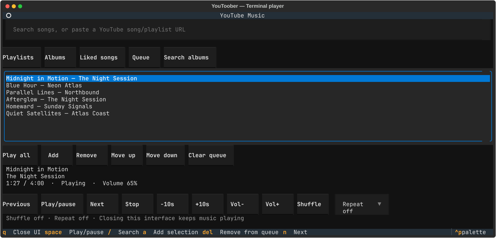
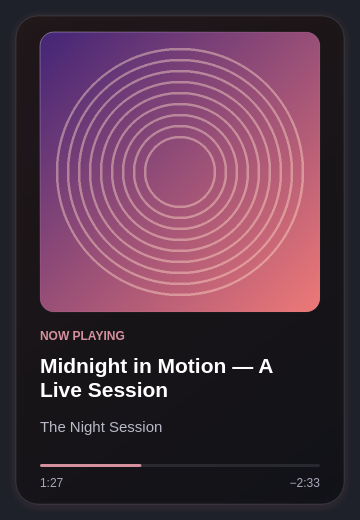
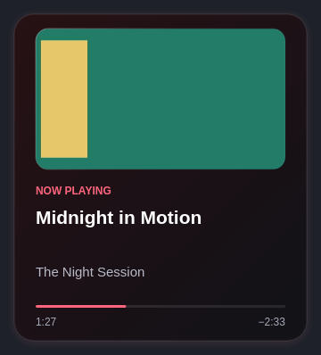
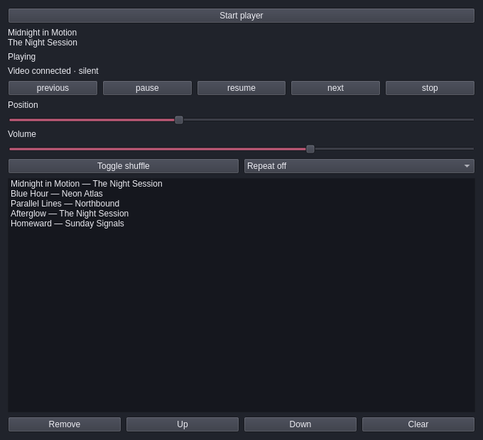

# YouToober

YouTube Music terminal player + native OBS plugin.

Play YouTube Music without keeping a browser page open. `ytm` opens a keyboard-driven terminal browser; individual commands and the OBS dock control the same background player. Closing either interface keeps playback running.

## Screenshots

Captured from the real terminal interface, native widget renderer, and OBS control dock using synthetic demo tracks. The artwork and video test frames are generated locally; no signed-in account or private library is shown.

**Terminal player** — browse music, edit the queue, and control playback.



| Album-art widget | Video widget |
| :---: | :---: |
|  |  |

**Native OBS controls** — the playback dock with a sample queue and silent video connected.



Capture notes and reproduction commands are in [docs/screenshots](docs/screenshots/README.md).

## Getting started

Run:

```sh
ytm auth  # One-time library authentication, performed locally in your terminal
# Or import saved headers directly:
ytm auth --headers-file ~/headers.txt
ytm       # Open the terminal interface
```

Install using the instructions below. The launcher is `~/.local/bin/ytm`; it runs from your checkout and its `.venv`, so keep both in place.

`ytm auth` guides you through importing authenticated YouTube Music request headers. Follow the [ytmusicapi instructions](https://ytmusicapi.readthedocs.io/en/stable/setup/browser.html). Credentials stay in `~/.config/ytmusic-cli/browser.json` with owner-only permissions. Do not paste them in chat, issue reports, or Git.

Public search works without authentication. Personal playlists, albums, library songs, and liked songs require the imported session. If YouTube requires playback cookies, explicitly configure a source:

```sh
ytm auth --cookies-browser chrome
# Or import a Netscape cookies file:
ytm auth --cookies-file /path/to/cookies.txt
```

Library authentication and playback cookies are separate. Browser-session expiry requires re-importing credentials; extraction errors explain how to retry. The app does not automate sign-in, run a hidden browser, or require OAuth client credentials. yt-dlp may need updating when YouTube changes playback requirements.

## Terminal controls

- Type a song query and press Enter, or paste a YouTube song/playlist URL.
- Use **Playlists**, **Albums**, **Liked songs**, **Queue**, or **Search albums** to change views.
- Arrow keys select a result; Enter opens a collection or plays a song.
- **Play all** plays a collection; **Add** / `a` appends the selection to the queue.
- **Remove**, **Move up/down**, and **Clear queue** edit the queue.
- Space toggles playback, `n` skips, `/` focuses search, and `q` closes the UI.
- Transport buttons provide seeking, volume, shuffle, and repeat.

The queue and playback settings are saved atomically. A service restart restores the session **paused**, including its last saved position. Saves occur on changes and every five seconds during playback. Repeat modes are off, one, and all. Shuffle plays the available queue without repeating a track before exhaustion. Previous restarts the current song after three seconds; otherwise it navigates back.

## Shell commands

```sh
ytm search 'artist song'
ytm search --filter albums 'album name'
ytm library playlists
ytm library albums
ytm library songs
ytm liked
ytm playlist PLAYLIST_ID
ytm album ALBUM_BROWSE_ID
ytm play 'https://music.youtube.com/watch?v=VIDEO_ID'
ytm enqueue 'https://music.youtube.com/playlist?list=PLAYLIST_ID'
ytm play --playlist PLAYLIST_ID
ytm play --album ALBUM_BROWSE_ID
ytm play --liked
ytm queue
ytm select 0
ytm move 0 2
ytm remove 1
ytm pause
ytm resume
ytm next
ytm previous
ytm seek 90
ytm volume 65
ytm shuffle on
ytm repeat all
ytm stop
ytm clear
ytm status
ytm service stop
```

Queue indices are zero-based. Commands return JSON. `play` appends its selection and begins playing there; `enqueue` appends without interrupting playback. Resolution happens just before each song, with one retry. The resolver prefers HLS audio, which passed the live playback check on this machine; only audio is played. A failure preserves the queue and waits for Resume/retry or Next instead of repeatedly skipping songs.

## OBS

Restart OBS after installation. Add **YouTube Music Now Playing** as a source, and open **Docks → YouTube Music**.

The native source is **360 × 520**, with a large square artwork tile above two title lines, artist, progress, and elapsed/remaining timestamps. Without artwork, the compact layout is 360 × 224. Scale it using OBS transforms; existing scenes may need their source transform adjusted after this update.

Source properties include:

- **Match accent and glow to album artwork**: chooses a readable color from the cover, with your manual accent as the fallback for missing or grayscale artwork.
- **Display mode**: always visible while playing (default), or briefly on song changes. Brief mode defaults to 12 seconds and fades out; the duration is adjustable from 5–60 seconds.
- **Replay entrance / preview**: replays the entrance using the current track, or shows an eight-second sample if no player is connected. It never starts playback, changes the queue, or contacts YouTube.
- Font, manual accent, background opacity, artwork visibility, progress, timestamps, pause visibility, animation enable/disable, and entrance duration.

First appearance uses the slide/fade/scale entrance; song changes crossfade the artwork, text, and matching colors over 550 ms. The tile has rounded framing, a soft shadow, and a faint highlight. Titles wrap to two lines and scroll slowly, with reading pauses, only when the full title needs more space. Short titles stay still. Timestamps include hours when needed; unknown durations show an em dash for remaining time.

The overlay retains the previous visual briefly during song loading so the next song can crossfade smoothly. Stops, errors, and disconnections hide it. No Browser Source or web server is involved.

### Optional music video

In the source's **Properties → Visual mode**, choose **Music video (up to 720p, silent)**. Artwork remains the default. Video mode uses a **360 × 398** card with a 16:9 tile, preserving the whole picture with letterboxing when needed. Hide the tile to use the existing compact layout.

The service resolves the video attached to the exact playing YouTube ID, caps input quality at 720p, and decodes silent frames with FFmpeg. The widget receives up to 24 fps at 640 × 360 over the owner-only Unix socket. Pause freezes the picture; seeking, resuming, and track changes follow the audio player. Seeking uses mpv’s exact-seek mode, and video frames are paced against its reported playback position. The video has no audio output, so your existing OBS audio capture remains the single sound source.

Artwork appears while video loads, stalls, or is unavailable. Some song uploads contain only static cover art; play a music-video URL with `ytm play URL` to select a different upload. The app does not substitute a different recording automatically.

Video processing starts only when a visible source requests it and stops a few seconds after requests cease. It is shared across video-enabled sources. The dock reports whether video is loading, connected, or unavailable. Temporary stream URLs and HTTP headers stay inside the local service; they are never put in OBS scene settings, normal status snapshots, or the saved queue. Preview mode does not start video extraction.

FFmpeg must be on PATH for video mode. After installing this update, restart OBS and the player service (`ytm service stop`, then `ytm service start`) when convenient. Restarting the player restores its session paused; use Resume to continue.

The dock has **Start player**, previous/pause/resume/next/stop, seeking, volume, shuffle/repeat, and queue editing. Double-click a queued track to play it. Multiple sources share one connection. The source and dock reconnect automatically when the service restarts.

Audio uses normal OBS desktop or application capture. The plugin does not capture or duplicate audio. Add/select the appropriate audio capture source in your scene and check the mixer before recording. Closing OBS or switching scenes leaves playback running.

Local previews: `build/overlay-polished.webp` (entrance), `build/overlay-crossfade.webp` (song change), and `build/overlay-polished-on-dark.png` (layout). These raw generated files are not committed; the curated screenshots above are stored in `docs/screenshots/`.

## Installation from a checkout

Linux requirements: Python 3.11+, mpv 0.38+, yt-dlp, FFmpeg (for video), CMake, a C++17 compiler, OBS development libraries, Qt6 Widgets/Network/Concurrent, and Wayland development libraries for the test harness. The native plugin targets OBS 33 and Qt 6.

```sh
python3 -m venv .venv
.venv/bin/pip install -e .
.venv/bin/python scripts/install.py
```

If using uv:

```sh
uv venv .venv
uv pip install --python .venv/bin/python -e .
.venv/bin/python scripts/install.py
```

The installer builds the module and writes only the user launcher, user service, and `~/.config/obs-studio/plugins/ytmusic-obs/bin/64bit/ytmusic-obs.so`. No root privileges or login autostart are required. The service starts on demand. The project does not depend on Docker or change other repositories.

```sh
ytm service start
ytm service status
ytm service stop
journalctl --user -u ytmusic-cli.service -n 50
```

When running directly from a checkout without installation, the CLI starts a detached service and logs to `~/.local/state/ytmusic-cli/service.log`.

Uninstall installed components with `.venv/bin/python scripts/uninstall.py`; credentials, artwork cache, and saved sessions are preserved. Restart OBS after removal. The uninstall script restores any pre-existing components backed up by the installer.

## Development and validation

```sh
.venv/bin/python -m unittest discover -s tests -v
cmake -S obs -B build/obs
cmake --build build/obs --parallel
ctest --test-dir build/obs --output-on-failure
QT_QPA_PLATFORM=offscreen QT_QPA_PLATFORMTHEME=generic QT_STYLE_OVERRIDE=Fusion \
  build/obs/ytmusic-obs-smoke "$PWD/build/obs/ytmusic-obs.so"
```

Tests cover queue editing, shuffle/repeat, EOF advancement, restoration, failure recovery, cancellation, real mpv IPC with silent output, simultaneous service clients, state subscriptions, protocol errors, permissions, shutdown, and the headless Textual UI. The deterministic Qt renderer test covers palette fallback, crossfades, loading/disconnection behavior, two-line title overflow, timestamp formatting, timed visibility, compact layout, offline preview, and 16:9 video framing/stale-frame fallback. The video tests cover real silent decoding, pause/seek behavior, track changes, idle cleanup, quality limits, bounded retries, and private frame responses. The native smoke harness loads the plugin into libobs and checks source properties and dock lifecycle. Pass `preview` after its output PNG argument to exercise the actual properties preview button with no service connected.

To generate a rendered native preview on a Wayland desktop, use a separate runtime directory so the harness cannot collide with the real player socket:

Run the smoke harness with an output PNG path as its second argument to capture an entrance-animation sequence. Give it a private temporary `XDG_RUNTIME_DIR` and an absolute `WAYLAND_DISPLAY` path so the synthetic player socket cannot collide with your real service. The harness uses the OBS OpenGL renderer and does not modify your scenes.

Validation covers public catalog search, real HLS streaming through silent mpv output, native source rendering, and the automated regression suite.

Personal-library and final scene/audio acceptance require your own authenticated session. A plugin load/render test is separate from checking an actual recording in your OBS scene collection.

## Local protocol

`video-frame` is an on-demand frame request with optional `after` revision. Its result contains `track_id`, `status` (`idle`, `loading`, `ready`, or `unavailable`), `revision`, `fps`, and an optional base64 JPEG `frame`. It never returns a resolved media URL or authentication headers.

The service listens at `$XDG_RUNTIME_DIR/ytmusic-cli-UID.sock`, with mode 0600, and uses a singleton file lock. It has no TCP listener. Requests are newline-delimited JSON:

```json
{"version":1,"id":7,"method":"volume","params":{"value":65}}
```

Responses echo the ID and contain `result`, or `error` with `code` and `message`. Use CLI command names as methods; collection reads accept `id`, queue edits accept zero-based `index`/`target`, and numeric controls accept `value`. `play`/`enqueue` accept a YouTube `url`, a collection `kind` plus `id`, or normalized `tracks`.

`subscribe` acknowledges the protocol version, sends an immediate snapshot, and streams events at most four times per second:

```json
{"event":"state","sequence":1,"state":{"status":"Stopped","queue":[],"index":-1,"track":{},"position":0,"duration":0,"volume":100,"shuffle":false,"repeat":"off","error":"","connected":true}}
```

Tracks include IDs, title, artist, album, duration, public YouTube URL, thumbnail URL, and cached artwork path. Credentials, playback cookies, HTTP headers, and resolved media URLs stay private to the service/backend and are never included in public snapshots.
